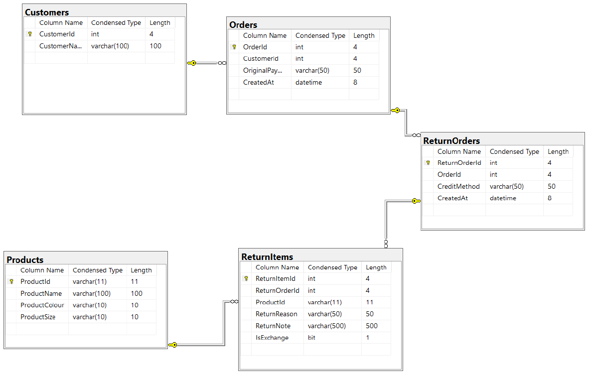
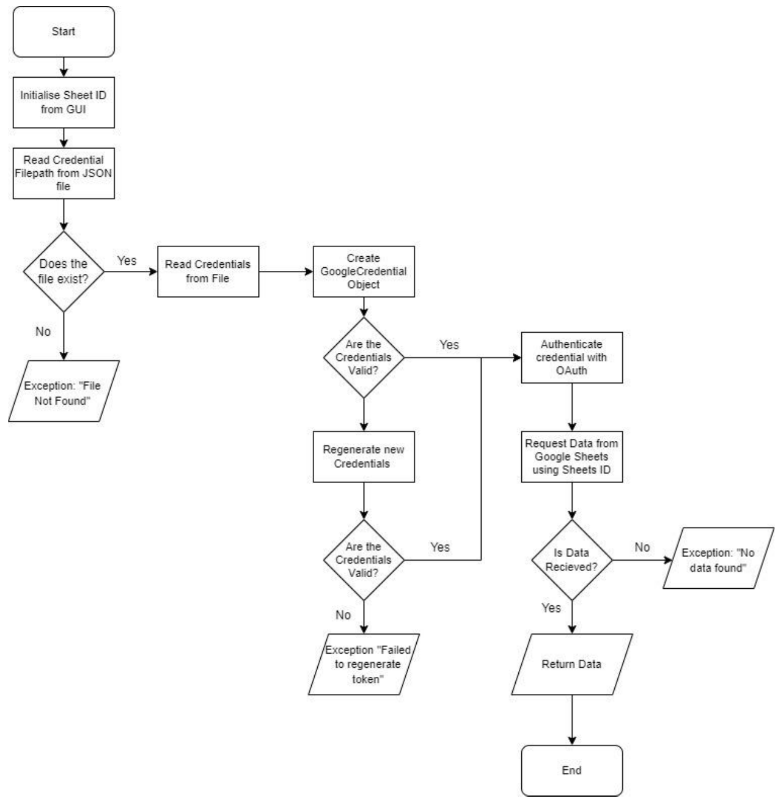

# Returns Management System

A Windows desktop app that pulls a retailer's returns data out of Google Sheets, validates it, loads it into a normalised SQL Server database, and gives non-technical staff a point-and-click interface for querying it.

Built in C# (.NET 8, Windows Forms) as my A-level Computer Science coursework (NEA). It was inspired by the returns process at a small UK clothing brand, and designed with input from a member of their team. **Graded A\*.**

## The problem

The brand logged returns in one large Google Sheet that staff reviewed by hand every day. As the sheet grew it got slow to work with, and there was no practical way to answer questions like:

- Is one customer returning items unusually often?
- Is a particular product, colour or size being returned at an abnormal rate?
- Which return reasons come up most, and how many returns become exchanges rather than refunds?
- Which rows were entered incorrectly and need fixing?

The goal was not to replace the existing returns portal or warehouse process, but to sit alongside them: take the data the team already collects, clean it, store it properly, and make it easy to search and analyse.

## Who it's for

Customer service and operations staff with no SQL or programming knowledge. They pick a dataset from a drop-down, wait for it to load, and then choose from a menu of ready-made queries.

## What it does

1. **Reads returns data from Google Sheets** through the Google Sheets API, with credential validation and token refresh.
2. **Validates and cleans each row** before it reaches the database:
   - rejects rows with missing or extra columns, missing or badly formatted SKUs, or values of the wrong type
   - detects duplicates using a composite key
   - splits each SKU into product line, colour and size
   - keeps every rejected row with the reason it was rejected, so staff can fix it at source
3. **Loads the clean data into SQL Server** using a schema in third normal form (Customers, Orders, ReturnOrders, Products, ReturnItems). The app drops and recreates its tables each time a dataset is loaded, and inserts are parameterised and wrapped in transactions with rollback.
4. **Shows a summary screen** with the date range covered and a bar chart of returns per month (months sorted with a recursive merge sort).
5. **Runs ready-made queries** from a drop-down menu:
   - Exchange vs return counts
   - Returns by month
   - Rank returned items by characteristic (product, colour or size)
   - Rank return reasons
   - Get order details by order ID
   - Get a customer's orders by name
   - Number of orders between two dates
   - View rejected data

## Design

**Database schema** (third normal form):



**Reading data from Google Sheets**, including credential checks and regeneration:



## Tech stack

| Area | Used |
|---|---|
| Language / runtime | C#, .NET 8 |
| UI | Windows Forms, OxyPlot (charts) |
| Database | SQL Server (ADO.NET via `System.Data.SqlClient`) |
| Data source | Google Sheets API v4 (`Google.Apis.Sheets.v4`, `Google.Apis.Auth`) |
| Configuration | `Microsoft.Extensions.Configuration.Json` |
| Testing | MSTest |
| Tools | Visual Studio 2022, SQL Server Management Studio |

## Project structure

```
NEAProjectMain/                 Main Windows Forms application
  ReadingAPI.cs                 Google Sheets API call and credential handling
  ProcessingAPIData.cs          Validation, SKU parsing, duplicate detection
  ConnectingToSQL.cs            Database connection and load pipeline
  SQLTabelManager.cs            Drop / create table scripts
  SQLInsert*.cs                 Parameterised, transactional inserts
  SQLSelect*.cs                 Query logic and SQL text
  SQLSelectClasses/             Result objects returned by queries
  Controller.cs                 Coordinates the GUI with the data layer
  GUI.cs, GUIQueryHandler.cs    User interface
  SettingsProgram.example.json  Template for local configuration
NEAUnitTests.Tests/             MSTest unit tests for the merge sort
docs/                           Design diagrams
```

## Setting it up

**Requirements:** Windows 10 or later, Visual Studio 2022 with the .NET 8 SDK, a local SQL Server instance, and a Google Cloud project with the Google Sheets API enabled.

1. **Clone the repo** and open `NEAProjectMain.sln` in Visual Studio.
2. **Create your config file.** In the `NEAProjectMain` folder, copy `SettingsProgram.example.json` to `SettingsProgram.json` and fill in:
   - `FilePaths:CredentialFilePath` – full path to your Google credentials JSON file (for example a service-account key) with read access to your sheet
   - `DatabaseConfig:ConnectionString` – connection string for an empty SQL Server database (the example uses Windows authentication)

   `SettingsProgram.json` is listed in `.gitignore`, so your real paths and connection string stay out of version control. The project will not build until this file exists.
3. **Point the app at your sheets.** In `NEAProjectMain/GUI.cs`, replace `YOUR_SHEET_ID_1` to `YOUR_SHEET_ID_3` with the IDs of your Google Sheets (the ID is the long string in the sheet's URL). Each sheet should have its data on `Sheet1` with nine columns: created at, order number, customer name, product name, SKU (`line-colour-size`), return reason, return note, credit method, and whether it is an exchange.
4. **Build and run.** The app creates its own tables when you load a dataset. Use a dedicated database: any existing tables named Customers, Orders, ReturnOrders, Products or ReturnItems will be dropped.

To run the tests: **Test > Run All Tests** in Visual Studio.

## What I'd improve

- Run database work asynchronously so the UI never freezes on large datasets.
- Speed up loading large sheets, for example with bulk inserts.
- Let users change query parameters and re-run without going back to the menu.
- Extend unit-test coverage beyond the merge sort, for example to the validation and SKU parsing.

## About

Rufus White – A-level Computer Science NEA, 2024–2025.

The full 150-page design, testing and evaluation report is available on request.
